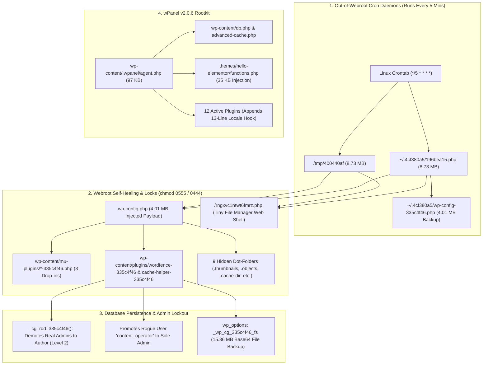

# Defeating a Self-Healing WordPress Multi-Rootkit
### Case Study & Server-Side Remediation Script (`0555` Locks, `4MB` `wp-config` Dropper, Linux Cron Daemons & `wPanel v2.0.6`)

**Author:** Muhammad Hussam ([@mHussamFaisal](https://github.com/mHussamFaisal))

---

## Overview & Business Context

This repository documents a real-world malware cleanup on a live UK airport transfer website taking **25+ bookings per day** on cPanel Linux hosting.

Because the website runs a custom booking application (`/eto/`) and a custom dispatch plugin alongside WordPress, wiping the server and reinstalling from scratch was not an option. We had to clean the server in-place without losing live bookings, custom pricing routes, or taking the booking engine offline.

### Symptoms We Ran Into
1. **Admin Accounts Demoted to Author:** Real administrators could still log in at `wp-login.php`, but the dashboard loaded without the admin menu (`user_level` was changed to `2` in `wp_usermeta`).
2. **Undeletable Folders (`chmod 0555` / `0444`):** Deleting the rogue plugin folders in cPanel File Manager failed silently, and folders moved to cPanel Trash could not be emptied (`FileOp Failure: Directory not empty`).
3. **Files Regenerating Every 5 Minutes (Even With `index.php` Disabled):** Even after renaming `index.php` to `indexdisable.php`, `wp-config.php` grew back to `4.01 MB` and a `221 KB` web shell (`rngxvc1ntwt6fmrz.php`) reappeared in the webroot with `0444` permissions every 5 minutes.

---

## How the Infection Worked



---

## What We Found on the Server

### 1. The `335c4f46` Self-Healing Kit
Disguised as `wp-content/plugins/wordfence-335c4f46/wordfence-335c4f46.php`, `cache-helper-335c4f46`, and `media-cache-335c4f46`, plus three `mu-plugins` (`custom-constants-335c4f46.php`, `db-helper-335c4f46.php`, `maintenance-helper-335c4f46.php`):

* **Admin Role Demoter (`_cg_rdd_335c4f46`):** Queries `wp_users`, saves the real admin roles into option `_wp_cg_335c4f46_rb`, demotes real admins to `author` (`wp_user_level = 2`), and leaves its own `content_operator` account as the only `administrator`.
* **`4.01 MB` `wp-config.php` Payload:** Injects a `4.01 MB` `/* cg-restore-335c4f46:START */` block into `wp-config.php`. Even when `index.php` is disabled, any request to `wp-cron.php`, `wp-login.php`, or `xmlrpc.php` loads `wp-config.php` and recreates deleted malware files.
* **Hidden Cron Jobs & Out-of-Webroot Scripts:** Deobfuscating the `8.73 MB` `196bea15.php` script revealed its hardcoded paths (`_T_OD`, `_T_OT`, `_T_OT2`, `_T_WCC`, `_T_DIRS`):
  * **`~/.4cf380a5/196bea15.php`** (`8.73 MB` standalone PHP script hidden in the cPanel home folder, one level above `public_html`)
  * **`~/.4cf380a5/wp-config-335c4f46.php`** (`4.01 MB` backup of the infected `wp-config.php`)
  * **`/tmp/400440af`** (`8.73 MB` standalone PHP script in `/tmp`)
  * **Three Linux Cron Jobs** in `/var/spool/cron/<user>`:
    ```cron
    */5 * * * * php /home/<user>/.4cf380a5//196bea15.php >/dev/null 2>&1
    @reboot php /tmp/400440af >/dev/null 2>&1
    */5 * * * * php /tmp/400440af >/dev/null 2>&1
    ```
* **Nine Hidden Dot-Folders in `wp-content/` (`~63 MB` total):**
  * `wp-content/uploads/2026/10/.thumbnails/`
  * `wp-content/upgrade/.temp/`
  * `wp-content/cache/.objects/`
  * `wp-content/languages/.cache/`
  * `wp-content/uploads/.cache-dir/`
  * `wp-content/themes/.starter-starter/`
  * `wp-content/upgrade/core/.backup/`
  * `wp-content/fonts/.woff-cache/`
  * `wp-content/debug/.logs/`
* **Database Backup Blob (`15.36 MB`):** Stored in `wp_options` under `_wp_cg_335c4f46_fs`.
* **Permission Locks (`0555` / `0444`):** Sets files to `0444` and parent directories to `0555` so cPanel File Manager cannot delete them.

### 2. `wPanel` v2.0.6 Rootkit
* Stored in `wp-content/.wpanel/agent.php` (`97 KB`), `wp-content/languages/class-wp-locale-switch.php`, `wp-content/languages/class-wp-locale-data.php`, and `wp-content/uploads/wp-locale-cache/index.php`.
* Drops `wp-content/db.php` and `wp-content/advanced-cache.php`.
* Injects `35 KB` (`// WPANEL:BEGIN`) into the active theme's `functions.php`.
* Hooks `wp_authenticate` to log plaintext admin passwords on login.
* Appends a 13-line `// WordPress locale data handler` loader to the end of 12 active plugins.

### 3. Secondary Payloads
* **EtherHiding (`fast-monitor-rig.php`):** Uses Ethereum RPC endpoints (`https://eth.llamarpc.com`, `https://0xrpc.io/eth`) in `wp_options` to fetch payloads.
* **Rogue Themes & Web Shells:** Rogue themes (`fvyejxc`, `nunolrm-*`), root Tiny File Manager shell (`/rngxvc1ntwt6fmrz.php`), and an uploader shell (`wp-content/uploads/c5b71bdd.php`).

---

## How We Cleaned It: Server-Side PHP Remediation Script

Because the malware locked folders to `0555`, ran every 5 minutes from cron jobs outside `public_html`, and bloated the database to `598 MB` (above phpMyAdmin's upload limit), we wrote **[`remediate_template.php`](./remediate_template.php)** and ran it directly on the server:

1. **Removed the Cron Jobs & Background Daemons:** Stripped the malicious lines from `/var/spool/cron/<user>` and `crontab -l`, and killed active processes (`pkill -f`).
2. **Neutralized Malware Files Before Unlinking:** Changed permissions to `0644` and overwrote each PHP file with `<?php exit;` before calling `unlink()`, so even if a file was locked, the cron job became a harmless no-op.
3. **Unlocked All `0555` / `0444` Directories (Including `~/.trash/`):** Recursively set directories back to `0755` and files to `0644` across `wp-content/`, `~/.4cf380a5/`, `/tmp/400440af`, and `~/.trash/`, allowing the stuck cPanel Trash folder to be emptied.
4. **Repaired Infected Files In-Place:** Stripped the `4.01 MB` `cg-restore` block from `wp-config.php`, removed `// WPANEL:BEGIN` from `functions.php`, and removed the 13-line `wPanel` hook from the 12 active plugins without touching our custom `/eto/` booking app or plugin code.
5. **Cleaned & Shrunk the Database:** Restored admin capabilities in `wp_usermeta`, deleted the rogue `content_operator` account, removed the `15.36 MB` `_wp_cg_335c4f46_fs` option, and cleared `362 MB` of old post revisions and `81 MB` of 404 logs (shrinking the database from `598 MB` down to `12 MB`).

---

## Other Issues Fixed Along the Way

1. **Cloudflare Flexible SSL & Broken `srcset` Images:**
   * `siteurl` and `home` in `wp_options` were set to `http://`, causing WordPress to output `srcset="http://..."` on `https://` pages (breaking responsive `` tags while CSS `background-image` URLs still worked).
   * Changing `siteurl` and `home` to `https://` behind Cloudflare Flexible SSL caused `ERR_TOO_MANY_REDIRECTS` until we added `HTTP_X_FORWARDED_PROTO` / `HTTP_CF_VISITOR` detection (`$_SERVER['HTTPS'] = 'on';`) to `wp-config.php`.
2. **Services Pages Returning Apache `500 Internal Server Error`:**
   * While the homepage (`/`) loaded fine via `DirectoryIndex index.php`, inner pages (`/airport-transfers/`, `/city-transfers/`) returned an Apache `500` error because `.htaccess` still had stale rewrite rules from when `index.php` was renamed to `indexdisable.php`.
3. **Unstyled Elementor Pages & `0-Byte` `wflogs` Files (`100%` Disk Quota):**
   * Elementor's `post-8.css`, `post-56.css`, and `post-63.css` files suddenly became `0 bytes`, and Wordfence's `wflogs/` filled up with `0-byte` `config.tmp.*` files.
   * Locked folders inside cPanel's `~/.trash/` plus temporary `.zip` backups had pushed the hosting account to `100%` disk quota (`0 bytes` free), causing Linux `fwrite()` calls to truncate regenerated CSS files to `0 bytes`. Unlocking and emptying `~/.trash/` freed `500+ MB` and fixed Elementor CSS generation immediately.

---

## Files in This Repo

* **[`remediate_template.php`](./remediate_template.php)** - Sanitized PHP server-side remediation script.
* **[`sql/remediate_admin_and_options.sql`](./sql/remediate_admin_and_options.sql)** - SQL queries to restore demoted admin roles and remove malware options.
* **[`docs/LinkedIn_Post_Draft.md`](./docs/LinkedIn_Post_Draft.md)** - Plain-text post summary.
