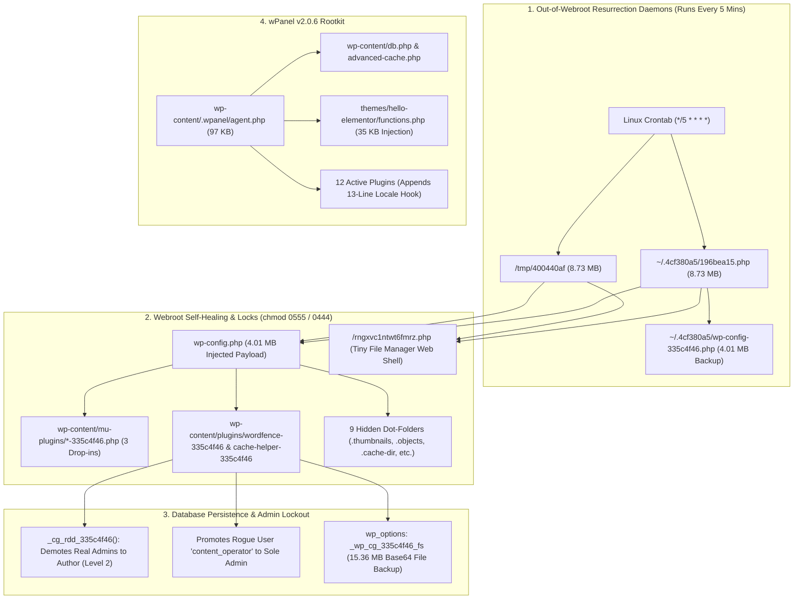

# 🛡️ Defeating a Self-Healing WordPress Multi-Rootkit
### Case Study & Server-Side Incident Response Toolkit (`0555` Locks, `4MB` `wp-config` Dropper, Linux Cron Daemons & `wPanel v2.0.6`)


**Author:** Muhammad Hussam ([@mHussamFaisal](https://github.com/mHussamFaisal))

---

## 📋 Overview

This repository documents a real-world incident response investigation and provides the **sanitized Server-Side Remediation Toolkit** used to eradicate five concurrent malware families from a production WordPress + custom PHP platform on shared/cPanel Linux hosting.

### Key Symptoms Investigated
1. **Silent Administrator Demotion:** Legitimate Administrators could log in at `wp-login.php`, but their `wp-admin` dashboard had no Administrator privileges (`user_level` demoted to `2` / `Author`).
2. **Undeletable Files (`chmod 0555` / `0444`):** Attempting to delete rogue plugins in cPanel File Manager failed silently, and moving folders to cPanel Trash caused `FileOp Failure: Directory not empty`.
3. **5-Minute Self-Resurrection (Even With `index.php` Disabled):** Deleting the rogue plugins or renaming `index.php` did not stop the infection—every 5 minutes, `wp-config.php` bloated back to `4.01 MB` and a `221 KB` web shell regenerated in the webroot with `0444` permissions.

---

## 🔬 Architecture of the Multi-Rootkit Infection



---

## 🦠 Malware Families Uncovered

### 1. The `335c4f46` Self-Healing Rootkit & SEO Spam Bridge
Disguised as `wp-content/plugins/wordfence-335c4f46/wordfence-335c4f46.php` (*"Unified Google insights bridge"*), `cache-helper-335c4f46`, and `media-cache-335c4f46`, plus three `mu-plugins` (`custom-constants-335c4f46.php`, `db-helper-335c4f46.php`, `maintenance-helper-335c4f46.php`):

* **Admin Role Demoter (`_cg_rdd_335c4f46`):** Queries `wp_users`, backs up original Administrator capabilities into `_wp_cg_335c4f46_rb`, demotes legitimate Admins to `author` (`wp_user_level = 2`), and leaves a rogue attacker account (`content_operator`) as the sole `administrator`.
* **`4.01 MB` `wp-config.php` Payload:** Injects a `4.01 MB` `/* cg-restore-335c4f46:START */` payload into `wp-config.php`. Even when `index.php` is disabled, any request to `wp-cron.php`, `wp-login.php`, or `xmlrpc.php` executes `wp-config.php` and restores deleted malware files.
* **Out-of-Webroot Linux Cron Daemons:** Deobfuscating the `8.73 MB` standalone script `196bea15.php` revealed its hardcoded constants (`_T_OD`, `_T_OT`, `_T_OT2`, `_T_WCC`, `_T_DIRS`):
  * **`~/.4cf380a5/196bea15.php`** (`8.73 MB` standalone PHP daemon hidden in the cPanel home directory, one level **above** `public_html`)
  * **`~/.4cf380a5/wp-config-335c4f46.php`** (`4.01 MB` infected `wp-config.php` backup)
  * **`/tmp/400440af`** (`8.73 MB` standalone PHP daemon in Linux `/tmp`)
  * **Three Linux Cron Jobs** in `/var/spool/cron/<user>`:
    ```cron
    */5 * * * * php /home/<user>/.4cf380a5//196bea15.php >/dev/null 2>&1
    @reboot php /tmp/400440af >/dev/null 2>&1
    */5 * * * * php /tmp/400440af >/dev/null 2>&1
    ```
* **Nine Hidden Dot-Folders inside `wp-content/` (`~63 MB` total):**
  1. `wp-content/uploads/2026/10/.thumbnails/`
  2. `wp-content/upgrade/.temp/`
  3. `wp-content/cache/.objects/`
  4. `wp-content/languages/.cache/`
  5. `wp-content/uploads/.cache-dir/`
  6. `wp-content/themes/.starter-starter/`
  7. `wp-content/upgrade/core/.backup/`
  8. `wp-content/fonts/.woff-cache/`
  9. `wp-content/debug/.logs/`
* **Database Filesystem Backup (`15.36 MB`):** Stored in `wp_options` under `_wp_cg_335c4f46_fs`.
* **Filesystem Permission Locks (`0555` / `0444`):** Locks files to `0444` and parent directories to `0555` (removing write permissions from the directory so `unlink()` and cPanel File Manager deletion fail).

### 2. `wPanel` v2.0.6 Rootkit & Credential Harvester
* Lives in `wp-content/.wpanel/agent.php` (`97 KB`), `wp-content/languages/class-wp-locale-switch.php`, `wp-content/languages/class-wp-locale-data.php`, and `wp-content/uploads/wp-locale-cache/index.php`.
* Drops malicious WordPress core drop-ins **`wp-content/db.php`** and **`wp-content/advanced-cache.php`**.
* Injects `35 KB` (`// WPANEL:BEGIN`) into the active theme's `functions.php`.
* Hooks `wp_authenticate` to capture plaintext Administrator passwords upon login.
* Appends a 13-line `// WordPress locale data handler` loader to the end of **12 active plugins**.

### 3. EtherHiding Blockchain Malware & Secondary Backdoors
* **EtherHiding (`fast-monitor-rig.php`):** Uses Ethereum JSON-RPC endpoints (`https://eth.llamarpc.com`, `https://0xrpc.io/eth`) stored in `wp_options` to fetch smart-contract C2 payloads.
* **Rogue Themes & Web Shells:** Rogue themes (`fvyejxc`, `nunolrm-*`), root Tiny File Manager shell (`/rngxvc1ntwt6fmrz.php`), and an obfuscated RCE uploader shell (`wp-content/uploads/c5b71bdd.php`).

---

## 🛠️ Engineering the Solution: Server-Side Remediation Script

When dealing with `0555` directory locks, 5-minute cron resurrection daemons, and `600 MB` databases on shared hosting without root SSH access, manual File Manager cleanup fails.

The **[`remediate_template.php`](./remediate_template.php)** script in this repository solves this in a single atomic HTTP request:

1. **Cron & Process Termination:** Strips malicious entries from `/var/spool/cron/<user>` and `crontab -l`, and terminates running background processes (`pkill -f`).
2. **Pre-Unlink Neutralization:** Before unlinking any malicious PHP file, the script changes permissions to `0644` and overwrites the file with `<?php exit;`—ensuring that even if CageFS/OS locks prevent deletion, cron executions become a harmless no-op.
3. **Recursive Permission Unlocker (`0555` → `0755`, `0444` → `0644`):** Unlocks `wp-content/`, `~/.4cf380a5/`, `/tmp/400440af`, and **`~/.trash/`** so stuck cPanel Trash folders can be emptied cleanly.
4. **Surgical Code Repair:** Strips the `4.01 MB` `cg-restore` block from `wp-config.php`, removes `// WPANEL:BEGIN` from `functions.php`, and strips the 13-line `// WordPress locale data handler` block from active plugins while preserving 100% of legitimate plugin and custom application code.

---

## 💡 Post-Remediation Production Lessons

1. **Cloudflare Flexible SSL & Broken `srcset` Images:**
   * If `siteurl` and `home` in `wp_options` are set to `http://`, WordPress outputs `srcset="http://..."` on `https://` pages, causing browsers to block responsive `` tags while CSS `background-image` URLs still render.
   * Switching `siteurl`/`home` to `https://` behind Cloudflare Flexible SSL causes `ERR_TOO_MANY_REDIRECTS` unless `HTTP_X_FORWARDED_PROTO` / `HTTP_CF_VISITOR` is mapped to `$_SERVER['HTTPS'] = 'on';` in `wp-config.php`.
2. **Inner Pages Returning Apache `500 Internal Server Error`:**
   * If the homepage (`/`) loads `200 OK` (via `DirectoryIndex index.php`) while all inner permalinks (`/services/`, `/contact/`) return an Apache `500 Internal Server Error`, check `.htaccess` for stale `RewriteRule` targets left behind from maintenance mode.
3. **Unstyled Elementor Pages & `0-Byte` `wflogs` Files (`100%` Disk Quota Exhaustion):**
   * When cPanel Disk Quota hits `100%` (`0 bytes` free—often due to locked files inside `~/.trash/`), Elementor's regenerated CSS files (`post-8.css`, `post-56.css`) and Wordfence's `wflogs/config.tmp.*` files are truncated to **`0 bytes`** by failed `fwrite()` calls. Unlocking and emptying `~/.trash/` immediately restores disk capacity.

---

## 📂 Repository Contents

* **[`remediate_template.php`](./remediate_template.php)** — Sanitized, token-protected PHP Server-Side Remediation Script.
* **[`sql/remediate_admin_and_options.sql`](./sql/remediate_admin_and_options.sql)** — SQL remediation queries to restore demoted Administrator roles and purge malware database options.
* **[`docs/LinkedIn_Post_Draft.md`](./docs/LinkedIn_Post_Draft.md)** — Summary write-up for sharing on LinkedIn.

---

## ⚠️ Disclaimer
This repository and script are provided for **defensive incident response, malware remediation, and educational purposes only**. Always back up your files and database before running remediation scripts in production, and delete the remediation script from your webroot immediately after use.
